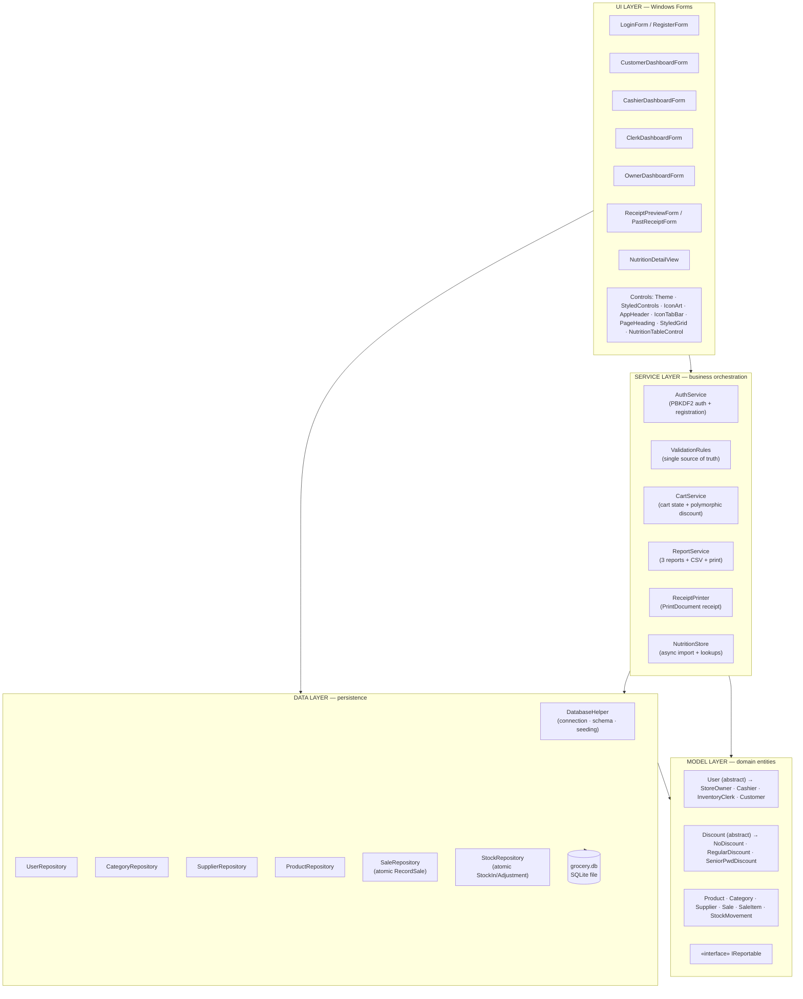
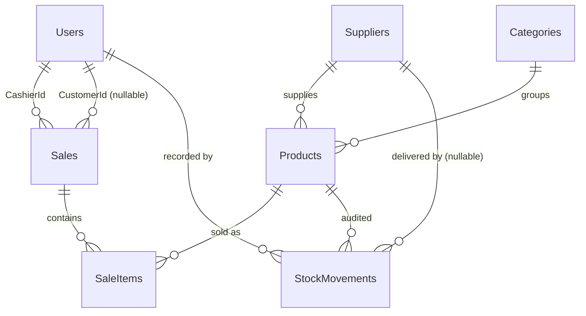
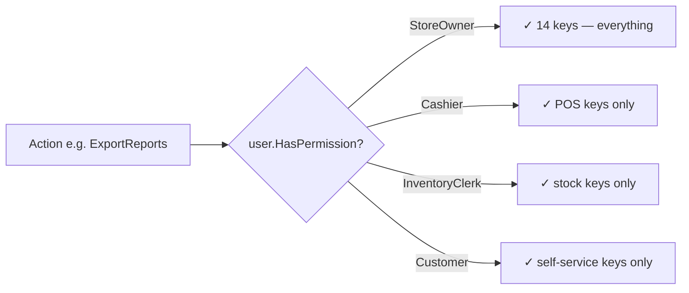
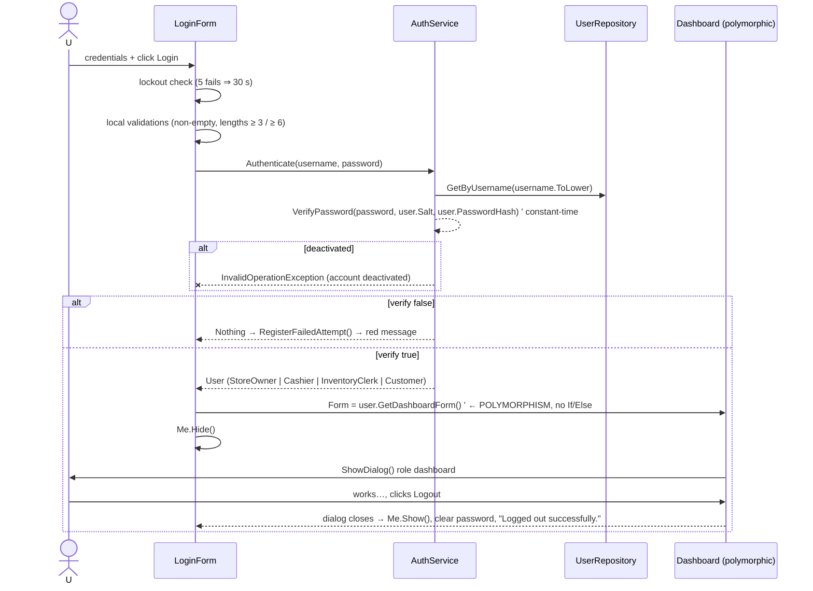

# Mini-Grocery Store POS & Daily Inventory System — Structure & Flow Documentation

> **Project:** Mini-Grocery Store Point-of-Sale & Daily Inventory System
> **Course:** Object-Oriented Programming (ITP 102) — *University of Caloocan City*
> **Platform:** VB.NET Windows Forms (Desktop), .NET Framework 4.7.2, SQLite (embedded, file-based)
> **Solution:** `oopfinals.sln` → single project **`oopfinals`** (RootNamespace `oopfinals`, entry point `oopfinals.My.MyApplication`, startup form `LoginForm`)
>
> This document describes **what the project is**, **how the codebase is structured**, and **how data flows through it at runtime** — layer by layer, class by class, and screen by screen.

---

## Table of Contents

1. [Project Purpose & Scope](#1-project-purpose--scope)
2. [Technology Stack](#2-technology-stack)
3. [Solution & Folder Structure](#3-solution--folder-structure)
4. [Layered Architecture](#4-layered-architecture)
5. [OOP Concepts Mapping (Where Each Pillar Lives)](#5-oop-concepts-mapping-where-each-pillar-lives)
6. [Model Layer (`Models/`)](#6-model-layer-models)
7. [Data Layer (`Data/`)](#7-data-layer-data)
8. [Database Schema (SQLite)](#8-database-schema-sqlite)
9. [Service Layer (`Services/`)](#9-service-layer-services)
10. [UI Layer (`Controls/` + `Forms/`)](#10-ui-layer-controls--forms)
11. [Role & Permission Model](#11-role--permission-model)
12. [Runtime Flows (Step-by-Step)](#12-runtime-flows-step-by-step)
13. [Security Model](#13-security-model)
14. [Validation Business Rules](#14-validation-business-rules)
15. [Seed Data & Demo Credentials](#15-seed-data--demo-credentials)
16. [Complete File Inventory](#16-complete-file-inventory)

---

## 1. Project Purpose & Scope

The system is a **desktop Point-of-Sale (POS) plus Daily Inventory Management application for a small neighborhood grocery store** (a "sari-sari scale" mini-grocery with Philippine Peso pricing, Filipino consumer goods, and Philippine statutory discounts). It was built as the finals project for an Object-Oriented Programming course, so every module is deliberately written to **demonstrate the four OOP pillars** (Abstraction, Encapsulation, Inheritance, Polymorphism) plus supporting concepts (interfaces, aggregation, single-responsibility separation, and transactional data integrity).

**Who uses it and what each role can do:**

| Role | Persona (seeded) | Primary responsibilities in the system |
|---|---|---|
| **Store Owner** | Maria Santos | Full administration: staff accounts, product catalog, categories, suppliers, prices, all transactions, reports (CSV export / print), inventory alerts, stock movements, nutrition catalog import |
| **Cashier** | Juan Dela Cruz | Front-counter POS: search/scan products, build a cart, apply discounts (None / Regular / Senior-PWD), take cash, compute change, print receipts, review today's transactions |
| **Inventory Clerk** | Pedro Penduko | Backroom: receive supplier deliveries (Stock-In), record stock adjustments with reasons, monitor low-stock / expiring / expired alerts, browse the movement audit trail, read-only catalog |
| **Customer** | Ana Batumbakal | Self-service portal: browse the product catalog (search + category filter), view personal purchase history & receipts, edit profile, change password |

**End-to-end capabilities:**

- **Authentication & identity** — new customer self-registration; PBKDF2-hashed passwords with per-user salts; brute-force lockout; role-based dashboard routing *without* an if/else chain (pure polymorphism).
- **Sales / checkout** — in-memory cart service; polymorphic discount strategy objects; atomic database transaction that writes the sale, line items, decrements inventory with an insufficient-stock guard, and appends audit-trail movements; sequential receipt numbering (`RCP-yyyyMMdd-####`); receipt preview + physical printing via `System.Drawing.Printing`.
- **Inventory management** — supplier deliveries (stock-in, with future-expiry validation and optional expiry update), manual adjustments (reason required, negative-stock prevention), and a full `StockMovements` audit trail covering `StockIn`, `Adjustment`, and `Sale` movement types.
- **Inventory intelligence / alerts** — low-stock (`StockQty <= ReorderLevel`), expired, and expiring-within-30-days classification computed by `Product` model helper methods.
- **Reporting & analytics** — Daily Sales Report, Inventory Valuation Report (cost vs. retail value, potential profit), and a Low-Stock & Expiry Alert Report; each with summary statistics, CSV export, and print support.
- **Nutrition catalog (bonus module)** — an Open Food Facts-style nutrition dataset (per-100g energy, protein, fat, carbs, sodium, serving size) imported asynchronously with progress reporting; lookups are honest "not found until imported," and records are classified **Verified** vs **Needs review**.
- **Consistent themed UI** — a Figma-derived design-token system (`Controls/Theme.vb`) with color/font/shape tokens, custom styled controls, icon art, tab bars, and datagrid styling shared by every dashboard.

---

## 2. Technology Stack

| Concern | Technology | Where it's used |
|---|---|---|
| Language | **Visual Basic .NET** (`Option Strict On`, `Option Explicit On` in every file) | Entire codebase |
| UI Framework | **Windows Forms** (`System.Windows.Forms`) | `Forms/`, `Controls/` |
| Graphics / Printing | **System.Drawing / System.Drawing.Printing** | `ReceiptPrinter`, `IconArt`, report printing |
| Database | **SQLite 3** via **System.Data.SQLite 1.0.119.0** (NuGet `Stub.System.Data.SQLite.Core.NetFramework`) | `Data/` layer; DB file auto-created at `bin\Debug\grocery.db` (non-destructive: `CREATE TABLE IF NOT EXISTS` + seed-once) |
| Cryptography | `Rfc2898DeriveBytes` (PBKDF2 / HMAC-SHA256), `RandomNumberGenerator` | `Services/AuthService.vb` |
| Concurrency / async | `Task`, `IProgress(Of T)`, `CancellationToken`, `SyncLock` | `Services/NutritionStore.vb` (demo import) |
| Data exchange | CSV export (escaped), `DataTable` | `ReportService.ExportDataTableToCsv` |
| Config | `App.config`, `My Project/Settings.settings`, `Application.myapp` (startup form = `LoginForm`) | Project shell |
| Target | .NET Framework **4.7.2**, `WinExe`, AnyCPU | `oopfinals.vbproj` |

Key language-level flags set project-wide (visible in `.vbproj`): `OptionExplicit On`, `OptionStrict On`, `OptionInfer On` — the entire codebase compiles under strict typing; no `Variant`-style late binding.

---

## 3. Solution & Folder Structure

```
oopfinals\
├── oopfinals.sln                        # Visual Studio solution
├── structureflow.md                     # ← this document
├── README.md
├── packages\                            # NuGet: System.Data.SQLite
└── oopfinals\                           # the project
    ├── oopfinals.vbproj                 # project file (compiles every .vb listed below)
    ├── App.config / packages.config
    ├── My Project\                      # VB "My" namespace shell
    │   ├── Application.myapp            # <MainForm>LoginForm</MainForm>, visual styles on
    │   ├── Application.Designer.vb      # MyApplication startup/shutdown plumbing
    │   ├── AssemblyInfo.vb
    │   ├── Resources(.resx/.Designer.vb)
    │   └── Settings(.settings/.Designer.vb)
    │
    ├── Models\        # 13 files — pure business entities + OOP hierarchies (no DB, no UI)
    ├── Data\          # 7 files  — SQLite access: schema, seeding, repositories, transactions
    ├── Services\      # 6 files  — business workflows: auth, cart, reports, printing, validation, nutrition
    ├── Controls\      # 9 files  — reusable themed UI components + design tokens
    └── Forms\         # 8 forms (+1 dialog) — each split into Form.vb (logic) + Form.Designer.vb (layout)
```

**Dependency rule (strictly one-directional):**

```
Forms ──► Services ──► Models          Forms ──► Data (repositories) ──► Models
  │                                      │
  └──────────► Controls ◄────────────────┘
Models ◄── referenced by every other layer, but Models never references Data/Services/Forms
```

`Models/` knows nothing about databases or screens (true domain layer). `Data/` maps SQLite rows ↔ `Models`. `Services/` orchestrates workflows using `Models` + `Data`. `Forms/` only binds UI events to Services/Repositories.

---

## 4. Layered Architecture

### 4.1 High-level view



### 4.2 Why three-plus layers

- **Models** = the OOP showcase (inheritance hierarchies, validating setters, computed properties).
- **Data** = encapsulation at the persistence boundary; every multi-write operation is wrapped in a `SQLiteTransaction` with rollback.
- **Services** = single-responsibility workflows (e.g., only `CartService` knows cart math; only `AuthService` touches passwords).
- **Controls** = the DRY layer for UI — every form pulls tokens/styles from `Theme` so no form hard-codes colors.

---

## 5. OOP Concepts Mapping (Where Each Pillar Lives)

Every header comment in the codebase tags its concept. Here is the authoritative map:

### 5.1 ABSTRACTION

| Where | Mechanism |
|---|---|
| `Models/User.vb` | `Public MustInherit Class User` declares `MustOverride GetRoleName()`, `GetDashboardForm()`, `GetPermissions()` — the *what* without the *how*. |
| `Models/Discount.vb` | `MustInherit Class Discount` declares `MustOverride Apply(subtotal As Decimal) As Decimal` — a pure discount *strategy contract*. |
| `Models/IReportable.vb` | `Public Interface IReportable` — contract with `ReportTitle`, `GeneratedDate`, `GenerateReportData() As DataTable`, `ExportToCsv(filePath) As Boolean`; decouples report generation from UI presentation. |
| Fingerprint projection | UI/DB layers program against the `User` base type and `Discount` base type, never against concrete subclasses. |

### 5.2 ENCAPSULATION

| Where | Mechanism |
|---|---|
| Every model | Private backing fields (`Private _stockQty As Integer`) + properties whose setters **validate and throw** (`ArgumentException("Stock quantity cannot be negative.")`). An invalid object state is impossible to construct. |
| `Models/Product.vb` | Strictest example: `Price`, `CostPrice`, `StockQty`, `ReorderLevel` reject negatives; `ProductCode` is trimmed/uppercased + non-empty; `CategoryId`/`SupplierId` must be > 0; `LineTotal`-style computed members are read-only. |
| `Models/SaleItem.vb` | `Quantity` must be > 0, `UnitPrice` ≥ 0, and `LineTotal` is a **get-only computed property** (`Quantity * UnitPrice`, rounded 2 dp, `MidpointRounding.AwayFromZero`) — clients can't corrupt it. |
| `Models/User.vb` | `PasswordHash` can never be set to empty (`Password hash cannot be empty.`); `Salt` exists separately so plaintext never exists in memory beyond login. |
| Utility classes | `AuthService`, `ValidationRules`, `Theme`, `NutritionStore`, `OffImportState` all have `Private Sub New()` — instantiating them is a compile-time error; they expose only `Shared` members. |
| `Services/CartService.vb` | Cart list is private; exposed only as `IReadOnlyList(Of SaleItem)` (`_items.AsReadOnly()`), so forms cannot mutate the cart directly — they must call `AddItem/UpdateItemQuantity/RemoveItem` which enforce stock limits. |

### 5.3 INHERITANCE

```
User (MustInherit)                     Discount (MustInherit)
├── StoreOwner    : User               ├── NoDiscount          : Discount  → Apply returns 0
├── Cashier       : User               ├── RegularDiscount     : Discount  → subtotal × pct (default 5%)
├── InventoryClerk: User               └── SeniorPwdDiscount   : Discount  → statutory subtotal × 20%
└── Customer      : User
```

- Each subclass calls the **protected base constructors** (`MyBase.New(...)`) of `User` (default + parameterized) — constructors chain properly, and `Role` is stamped inside each concrete constructor.
- `Discount` subclasses share the protected `_discountName` / `_percentage` state and a validating protected constructor (percentage clamped 0–100, `ArgumentOutOfRangeException` otherwise).
- `Product` helpers (`IsLowStock`, `IsExpired`, `IsExpiringSoon`, `GetStockStatus`) are reused by the Clerk alerts, Owner reports, and Customer catalog — one definition, three consumers.

### 5.4 POLYMORPHISM — the two showcase moments

**1. Dashboard routing (the login "aha" moment)** — in `Forms/LoginForm.vb`:

```vb
' loggedInUser is declared as the ABSTRACT base type User…
Dim loggedInUser As User = AuthService.Authenticate(username, password)
…
' …yet the overridden GetDashboardForm() is resolved at RUNTIME.
' No Select Case. No If/Else chain. The concrete subclass (StoreOwner,
' Cashier, InventoryClerk, Customer) decides which Form is opened.
Dim dashboard As Form = loggedInUser.GetDashboardForm()
Me.Hide()
dashboard.ShowDialog()
```

**2. Discount strategy swap** — in `Services/CartService.vb` (Strategy pattern):

```vb
Public Property CurrentDiscount As Discount   ' base-type reference, swappable at runtime

Public Function GetDiscountAmount() As Decimal
    Return CurrentDiscount.Apply(GetSubtotal())   ' overridden Apply() of whatever strategy is installed
End Function
```

The Cashier form's discount combo box simply installs `New NoDiscount()`, `New RegularDiscount(10)` (or other rate) or `New SeniorPwdDiscount()` into the same property — checkout math needs zero changes.

**Also polymorphic:**
- `User.HasPermission(permissionKey)` (`Overridable`) calls the `MustOverride GetPermissions()` — late-bound dispatch back into the subclass.
- `ToString()` overrides on `Product` (`PRD001 - Dinorado Special Rice 5kg (PHP 280.00)`) and `Discount` (`Senior Citizen / PWD (20%)`) make combo boxes readable without extra plumbing.

### 5.5 Other supporting concepts

| Concept | Where |
|---|---|
| **Aggregation / Composition** | `Sale.Items As List(Of SaleItem)` — a receipt *has* line items; `CartService` aggregates line items for the working cart. |
| **Interface contract** | `IReportable` (title/date/data/CSV export) for reporting modules. |
| **Factory-method flavor** | `GetDashboardForm()` behaves as a factory producing the correct dashboard per runtime type. |
| **Single Responsibility** | Each Service does exactly one workflow: auth, cart, reports, print, validate, nutrition. |
| **Encapsulation of transactions** | Repositories hide `BEGIN/COMMIT/ROLLBACK` from callers — `RecordSale`/`RecordStockIn`/`RecordAdjustment` are atomic units of work. |
| **Constant-time comparison** | `AuthService.SlowEquals` — timing-attack-resistant password check (security engineering detail). |

---

## 6. Model Layer (`Models/`)

13 source files. All namespaces `oopfinals.Models`. All headers document the project, course, class name, and OOP concept.

### 6.1 `User.vb` — Abstract base class (154 lines)

- Fields: `_userId, _username, _passwordHash, _salt, _fullName, _role, _isActive, _createdAt` — all private.
- All properties validate on set: `Username` non-empty (also normalized `.Trim().ToLowerInvariant()`), `PasswordHash` non-empty, `FullName` non-empty.
- Protected constructors: `New()` (defaults `IsActive=True`, `CreatedAt=Now`) and `New(userId, username, fullName, role, isActive)` (chains default ctor).
- Abstract contract: `GetRoleName()`, `GetDashboardForm() As Form`, `GetPermissions() As List(Of String)`.
- Concrete virtual: `HasPermission(permissionKey)` — false on empty key; otherwise membership test against `GetPermissions()` (late-bound).
- `ToString()` → `"Maria Santos (Store Owner) - @owner"`.

### 6.2 The four concrete users

| Class | `GetRoleName()` | Dashboard produced | Permission keys (exact strings) |
|---|---|---|---|
| `StoreOwner.vb` | "Store Owner" | `Forms.OwnerDashboardForm(Me)` | ManageStaff, ManageProducts, ManagePrices, ManageCategories, ManageSuppliers, ViewAllTransactions, ViewReports, ExportReports, PrintReports, StockIn, StockAdjustment, ViewInventoryAlerts, ViewStockMovements, ProcessSale |
| `Cashier.vb` | "Cashier" | `Forms.CashierDashboardForm(Me)` | ProcessSale, ViewTodayTransactions, ApplyDiscounts, PrintReceipt, LookupProducts |
| `InventoryClerk.vb` | "Inventory Clerk" | `Forms.ClerkDashboardForm(Me)` | StockIn, StockAdjustment, ViewInventoryAlerts, ViewStockMovements, BrowseProductsReadOnly |
| `Customer.vb` | "Customer" | `Forms.CustomerDashboardForm(Me)` | ViewProducts, ViewPurchaseHistory, ManageProfile |

Each holds `Private ReadOnly _<role>` reference typed to its concrete class — e.g. `CashierDashboardForm` receives the strongly-typed `Cashier` so it can safely use `UserId`/`FullName` without casts.

### 6.3 `Product.vb` — Core inventory entity (205 lines)

| Property | Validation on set |
|---|---|
| `ProductCode` | Non-empty; normalized `.Trim().ToUpperInvariant()` |
| `Name` | Non-empty |
| `CategoryId` / `SupplierId` | Must be > 0 (`A valid Category must be selected.`) |
| `CategoryName` / `SupplierName` | Display-only (no validation) |
| `Price`, `CostPrice` | ≥ 0 |
| `StockQty`, `ReorderLevel` | ≥ 0 |
| `ExpiryDate` | `Nullable(Of DateTime)` |
| `IsActive` | soft-delete flag |

Business helpers (used by alerts + reports + customer catalog):
- `IsLowStock()` → `StockQty <= ReorderLevel`
- `IsExpired()` → expiry date strictly before today
- `IsExpiringSoon(daysThreshold:=30)` → days-left ∈ [0, 30]
- `GetStockStatus()` → "Out of Stock" / "Low Stock" / "In Stock"

Constructor defaults: `_isActive = True`, `_reorderLevel = 10`.

### 6.4 `Sale.vb` + `SaleItem.vb` — Receipt + line items

- `Sale`: `SaleId, ReceiptNo (unique), SaleDate, CashierId, CashierName, CustomerId (Nullable — walk-in support), CustomerName, Subtotal, DiscountType (default "None"), DiscountAmount, Total, CashReceived, ChangeAmount, Items As List(Of SaleItem)`.
- All money setters reject negatives; `DiscountAmount` includes the human-readable discount name in `DiscountType`.
- `SaleItem`: `SaleItemId, SaleId, ProductId, ProductCode, ProductName, Quantity (>0), UnitPrice (≥0)`; get-only `LineTotal = Round(Quantity × UnitPrice, 2)`.

### 6.5 `StockMovement.vb` — Immutable audit record

Fields: `MovementId, ProductId, ProductCode, ProductName, MovementType` (`"StockIn" | "Adjustment" | "Sale"`), `QuantityChange` (+in / −out), `Reason, SupplierId (Nullable), SupplierName, UserId, UserName, MovementDate`. Default `MovementType = "Adjustment"`, `MovementDate = Now`. Every stock touch in the system eventually lands here — including automatic negative entries written by POS sales (`Reason = "POS Sale: RCP-20261103-0001"`).

### 6.6 `Discount.vb` — Strategy hierarchy (107 lines, 4 classes in one file)

| Class | Name shown in UI | Rate | `Apply(subtotal)` behavior |
|---|---|---|---|
| `Discount` (MustInherit) | — | — | Contract + protected validating ctor (name non-empty; % ∈ [0,100]) |
| `NoDiscount` | "None (0%)" | 0 | Returns `0` |
| `RegularDiscount` | "Regular / Promo (5%)" (rate configurable via optional ctor arg) | default 5% | `Round(subtotal × pct/100, 2, AwayFromZero)`; 0 when subtotal ≤ 0 |
| `SeniorPwdDiscount` | "Senior Citizen / PWD (20%)" | 20% | Hard-coded statutory 20% (Philippine RA 9994 / RA 10754 style grocery discount) |

### 6.7 `IReportable.vb` — Interface

```vb
Public Interface IReportable
    ReadOnly Property ReportTitle As String
    ReadOnly Property GeneratedDate As DateTime
    Function GenerateReportData() As DataTable
    Function ExportToCsv(filePath As String) As Boolean
End Interface
```

### 6.8 Supporting entities

- `Category.vb` (`CategoryId, Name`) and `Supplier.vb` (`SupplierId, Name, ContactNumber, Address`) — simple safe SQL id + read-only catalog, with parameterized `AddCategoryById` to avoid SQL injection.

---

## 7. Data Layer (`Data/`)

7 files, namespace `oopfinals.Data`. All SQL is **parameterized** (`@param` + `Parameters.AddWithValue`) — no string concatenation, no SQL injection surface.

### 7.1 `DatabaseHelper.vb` — Connection, schema, seeding (309 lines)

- **DB location:** `AppDomain.CurrentDomain.BaseDirectory + "grocery.db"` → Debug run: `bin\Debug\grocery.db`.
- **Connection string:** `Data Source={path};Version=3;Foreign Keys=True;` — FK enforcement on.
- `GetConnection()` — opens + returns a fresh `SQLiteConnection`.
- `InitializeDatabase()` — idempotent; called from `LoginForm_Load` on every app start:
  1. detects `isNewDb = Not File.Exists(...)` (stored for future use),
  2. runs the seven `CREATE TABLE IF NOT EXISTS` DDL statements (§8),
  3. calls `SeedInitialDataIfEmpty(conn)`.
- **Seeding (`SeedInitialDataIfEmpty`)** — guarded by `SELECT COUNT(*) FROM Users = 0`; the whole seed (4 users + 6 categories + 3 suppliers + 30 products + 30 initial stock movements) executes inside **one `SQLiteTransaction` with rollback on any failure**. Iterate over seed-structures (`SeedUser`, `SeedSupplier`, `SeedProduct`). Trusted code path so seed entities can use ORM style while user-facing flows use safe SQL.
- Seed products are realistic Filipino grocery items (Dinorado rice, Mega sardines, Lucky Me! Pancit Canton, Coke 1.5L, Piattos, Safeguard, Colgate…) spanning all 6 categories and 3 suppliers, with **many purposely borderline rows** to light up every screen: low-stock items (qty ≤ reorder), already-expired, and expiring-within-30-days.

### 7.2 `UserRepository.vb` — Identity persistence (206 lines)

Public API:
- `GetByUsername(username) As User` → SELECT, then **role string → subclass factory dispatch** (`StoreOwner` ⇒ `New StoreOwner(...)` etc.), running the matching dashboard on success.
- `GetById(userId) As User`
- `GetAllStaff() As List(Of User)` (Owner, Cashier, InventoryClerk)
- `GetAllCustomers() As List(Of Customer)`
- `UsernameExists(username) As Boolean`
- `CreateUser(user As User) As Integer` (polymorphic insert keyed on `user.Role`)
- `UpdateUser(user As User) As Boolean`
- `UpdatePassword(userId, newHash, newSalt) As Boolean` (used by "change password" + owner reset)
- `SetActiveStatus(userId, isActive)` (activate/deactivate account)

### 7.3 `CategoryRepository.vb` / `SupplierRepository.vb` — Master data

- `CategoryRepository`: `GetAll()`, `GetById(id)`, `Add(name)`, `Update(id, name)`, `Delete(id)`.
- `SupplierRepository`: `GetAll()`, `GetById(id)`, `Add(supplier)`, `Update(supplier)`, `Delete(id)`.
- Both are safe delete forms — UI usually protect-level low-impact actions; relied on by Owner Master-Data tab (plus caching of selected `Supplier`/`Category` rows, re-reading inside `GetAll` mappings).

### 7.4 `ProductRepository.vb` — Catalog & alerts (236 lines)

- `GetAll(activeOnly:=True)` — JOINs Categories + Suppliers to fill `CategoryName` / `SupplierName` display props.
- `Search(keyword, categoryId, activeOnly)` — LIKE search on code/name (+optional category filter).
- `GetById(id)`, `GetByCode(code)`.
- `Add(p) As Integer`, `Update(p) As Boolean`, `UpdatePrice(productId, newPrice, newCostPrice)`.
- `DeleteOrDeactivate(productId)` — soft-disable preferred (`IsActive=0`) rather than hard delete.
- **Alert queries:** `GetLowStockProducts()` (qty ≤ reorder), `GetExpiringProducts(daysThreshold:=30)`, `GetExpiredProducts()`.

### 7.5 `SaleRepository.vb` — The atomic checkout (286 lines) ⭐

- `GenerateReceiptNumber()` → `RCP-{yyyyMMdd}-{count of today's receipts + 1, padded D4}` (e.g. `RCP-20261103-0007`).
- `RecordSale(sale, items) As Integer` — the transactional core of the POS:

```
BEGIN TRANSACTION
  ① INSERT INTO Sales …; SELECT last_insert_rowid()  → saleId
  ② For each cart item:
       INSERT INTO SaleItems (…)
       UPDATE Products SET StockQty = StockQty - @qty
              WHERE ProductId = @pid AND StockQty >= @qty;
              → if 0 rows affected ⇒ THROW "Insufficient stock … Transaction cancelled."  (guard against races)
       INSERT INTO StockMovements ('Sale', −qty, reason:"POS Sale: RCP-…", cashierId)
COMMIT            ← on the least exception: ROLLBACK + rethrow
```

- Validation on entry: sale ≠ Nothing, ≥ 1 item, Total > 0, and `sale.Subtotal` **must equal** the rounded sum of `LineTotal`s (defense-in-depth against UI/service math drift).
- Read side:
  - `GetById(saleId)`, `GetByReceiptNo(receiptNo)` (with JOINs to resolve `CashierName`/`CustomerName`, defaults "Cashier"/"Walk-In"),
  - `GetSaleItems(saleId) As List(Of SaleItem)`,
  - `GetSalesByDate(d) As List(Of Sale)` (used by cashier "Today" tab),
  - `GetSalesByDateRange(start, end)` (owner transactions tab),
  - `GetSalesByCustomer(customerId)` (customer history tab),
  - `GetSalesByCashierAndDate(cashierId, d)` (per-cashier reconciliation).

### 7.6 `StockRepository.vb` — Inventory operations (181 lines) ⭐

- `RecordStockIn(productId, quantity, supplierId, userId, newExpiryDate, reason)`:
  - rejects `quantity ≤ 0` and `quantity > 10000` ("per delivery cap"),
  - **rejects past-dated expiry** — `"Expired stock must be rejected, not received. Record a disposal adjustment instead."`,
  - inside a transaction: `StockQty = StockQty + @qty` (+ optional `ExpiryDate = @exp`), then `StockMovements('StockIn', +qty, supplierId)`.
- `RecordAdjustment(productId, quantityChange, reason, userId)`:
  - requires `quantityChange ≠ 0` and a **non-empty reason**,
  - pre-checks `currentQty + change ≥ 0` ("Adjustment would result in negative stock…") so stock can never go negative,
  - transaction: `StockQty = StockQty + @change` + `StockMovements('Adjustment', change, NULL supplier)`.
- `GetMovements(Optional productId, Optional movementType, Optional startDate, Optional endDate)` — filters for the Clerk Movements tab + Owner ViewStockMovements.

---

## 8. Database Schema (SQLite)

Seven tables. `UserId` doubles for both cashiers (`Sales.CashierId`) and customers (`Sales.CustomerId`) — the `Users` table is role-generic.



| Table | Columns | Notes |
|---|---|---|
| **Users** | `UserId PK AUTOINCREMENT, Username UNIQUE NOT NULL, PasswordHash NOT NULL, Salt NOT NULL, FullName NOT NULL, Role NOT NULL, IsActive DEFAULT 1, CreatedAt NOT NULL` | Role ∈ {StoreOwner, Cashier, InventoryClerk, Customer}; passwords stored **only** as PBKDF2 hash + per-user salt |
| **Categories** | `CategoryId PK, Name UNIQUE NOT NULL` | 6 seeded |
| **Suppliers** | `SupplierId PK, Name NOT NULL, ContactNumber, Address` | 3 seeded |
| **Products** | `ProductId PK, ProductCode UNIQUE NOT NULL, Name NOT NULL, CategoryId FK→Categories, SupplierId FK→Suppliers, Price REAL, CostPrice REAL, StockQty INTEGER, ReorderLevel INTEGER, ExpiryDate TEXT (nullable), IsActive DEFAULT 1` | soft-delete via IsActive |
| **Sales** | `SaleId PK, ReceiptNo UNIQUE NOT NULL, SaleDate TEXT NOT NULL, CashierId FK→Users, CustomerId FK→Users NULL, Subtotal, DiscountType, DiscountAmount, Total, CashReceived, ChangeAmount` | one row per receipt |
| **SaleItems** | `SaleItemId PK, SaleId FK→Sales, ProductId FK→Products, Quantity, UnitPrice, LineTotal` | frozen price at sale time |
| **StockMovements** | `MovementId PK, ProductId FK→Products, MovementType ('StockIn'/'Adjustment'/'Sale'), QuantityChange (+/−), Reason, SupplierId FK→Suppliers NULL, UserId FK→Users, MovementDate` | the complete inventory audit trail |

Date/time stored as ISO-8601 text (`yyyy-MM-dd HH:mm:ss`); money as `REAL` (rounded 2 dp at the model boundary with `MidpointRounding.AwayFromZero`); `Decimal` ↔ `Convert.ToDecimal(reader(...))` mapping in repositories.

---

## 9. Service Layer (`Services/`)

6 files, namespace `oopfinals.Services` — all stateless except the intentionally stateful `CartService` / `NutritionStore`.

### 9.1 `AuthService.vb` — Authentication & registration (124 lines) 🔒

- `NotInheritable` + `Private Sub New()` (static utility).
- **Crypto constants:** `SaltSize = 16` bytes (Base64), `HashSize = 32` bytes, `Iterations = 10000` (PBKDF2 via `Rfc2898DeriveBytes`).
- `GenerateSalt()` — cryptographically random 16 bytes.
- `HashPassword(password, saltBase64)` — PBKDF2 → 32-byte key → Base64. Throws on empty password.
- `VerifyPassword(password, salt, expectedHash)` — recompute + `SlowEquals` (constant-time compare: XOR length, XOR char codes, cumulative `diff Or …`, single `diff = 0` result) to defeat timing attacks.
- `Authenticate(username, plainPassword) As User`:
  1. fence on null/whitespace,
  2. `UserRepository.GetByUsername` (lowercased),
  3. deactivated accounts throw `InvalidOperationException("This account has been deactivated. Please contact the Store Owner.")`,
  4. verify → return **the polymorphic subclass instance** (`StoreOwner`/`Cashier`/…),
  5. any miss → `Nothing`.
- `RegisterCustomer(username, plainPassword, fullName)` — public self-signup: validates via `ValidationRules` (throws `ArgumentException` with friendly messages), rejects taken usernames, salts+hashes, builds a `Customer` instance, and inserts via `CreateUser`.

### 9.2 `ValidationRules.vb` — Single source of truth (63 lines)

| Constant | Value |
|---|---|
| `MinUsernameLength` / `MaxUsernameLength` | 3 / 20 |
| `MinPasswordLength` | 6 |
| `MaxMoney` | ₱999,999.99 |
| `MaxQuantity` | 999 |

- `IsValidUsername` — `^[A-Za-z0-9._]+$`, 3–20 chars.
- `IsValidFullName` — at least one letter, no digits/symbols (letters/spaces/hyphen/apostrophe/dot/comma allowed).
- `IsValidPassword` — ≥ 6 chars, **no whitespace anywhere**.
- `IsValidMoney` — ≥ 0, ≤ MaxMoney, at most 2 decimals.
- `IsValidContactNumber` — `^[0-9+\-]{7,15}$`.

Used by Login, Register, Owner's staff tooling, and Customer profile — the exact same rule set everywhere.

### 9.3 `CartService.vb` — in-memory cart + money math (142 lines) 🛒

- State: `Private ReadOnly _items As List(Of SaleItem)` + `_currentDiscount As Discount` (defaults `New NoDiscount()`).
- `Items As IReadOnlyList(Of SaleItem)` — read-only exposure (encapsulation).
- `AddItem(product, requestedQty)` — merges into an existing line (`existing.Quantity + requestedQty`) but first checks the **combined** qty against `product.StockQty`, throwing `InvalidOperationException` with available stock in the message.
- `UpdateItemQuantity(productId, newQty, availableStock)` — 0/negative ⇒ `RemoveItem`; over-stock ⇒ throw.
- `RemoveItem(productId)`, `ClearCart()` (also resets discount to `NoDiscount`).
- `GetSubtotal()` — Σ `LineTotal`.
- `GetDiscountAmount()` — **`CurrentDiscount.Apply(subtotal)` — the polymorphic call**.
- `GetNetTotal()` — `Round(subtotal − discount, 2)` floor(min 0).
- `ComputeChange(cashReceived)` — guards empty cart and `cash < total` ("Insufficient cash. Total due is PHP …"), returns rounded change.
- `GetTotalItemCount()` — Σ `Quantity` (badge-friendly).

### 9.4 `ReportService.vb` — Reports + export + print (225 lines) 📊

Three `DataTable` generators, each also returning `ByRef summaryStats As Dictionary(Of String, Object)`:

| Report | Rows | Summary stats |
|---|---|---|
| **Daily Sales** (`GenerateDailySalesReport(date)`) | Receipt No · Time · Cashier · Customer · Gross · Discount · Net (per transaction of that day) | `TransactionCount`, `TotalGross`, `TotalDiscount`, `TotalNet` |
| **Inventory Valuation** (`GenerateInventoryReport()`) | Code · Name · Category · Qty · Cost Price · Retail Price · Total Cost Value · Total Retail Value · Status (uses `Product.GetStockStatus()`) | `TotalProducts`, `TotalUnits`, `TotalCostValue`, `TotalRetailValue`, `PotentialProfit` (= retail − cost) |
| **Low-Stock & Expiry** (`GenerateLowStockAndExpiryReport()`) | every product matching low-stock OR expired OR expiring-soon(30), tagged `EXPIRED` / `LOW STOCK & EXPIRING` / `LOW STOCK` / `EXPIRING SOON` | (none — self-explanatory list) |

- `ExportDataTableToCsv(dt, filePath)` — header row + escaped CSV (`""` for embedded quotes, per-field quoting), used for `ExportReports` permission.
- `PrintReport(title, dt, owner)` — prints a `DataGridView`-style tabular report via `PrintDocument` with page header (title + `GeneratedDate`).

### 9.5 `ReceiptPrinter.vb` — Receipt text + hardware printing (170 lines) 🧾

- Constructed around a `Sale` (`Sale Is Nothing` → `ArgumentNullException`).
- `GenerateReceiptText()` — fixed-width 48-column receipt: store header ("MINI-GROCERY STORE POS · University of Caloocan City - CSD · Biglang Awa St., Caloocan City · (02) 8310-1234"), receipt no / date-time / cashier / optional customer line, item table (`NAME(−20) QTY(5) PRICE(10) TOTAL(10)`), summary block (subtotal, `Discount (Senior Citizen / PWD): −PHP …` when > 0, TOTAL DUE, Cash Tendered, Change), and an "SALES INVOICE / OFFICIAL RECEIPT" footer.
- `ShowPrintPreview(owner)` — `PrintDocument` + `PrintPreviewDialog` (`PrintPageHandler` renders monospace lines).
- `PrintDirectly()` — straight to the default printer (PhysicalReceipt path).

### 9.6 `NutritionStore.vb` — Async nutrition module (206 lines) 🥗

- Domain: `NutritionRecord` — `ProductId, ProductCode, HasPer100, EnergyKcal, ProteinG, FatG, CarbsG, SodiumMg (Nullable), ServingSizeG (Nullable), IsPerServingMissing, SourceName ("Open Food Facts"), SourceDate, ImportedBy`.
- **Storage:** in-memory, `SyncLock`-protected `Dictionary(Of String, NutritionRecord)` keyed by seeded product code (`PRD001…PRD030`). 25 grocery items carry plausible per-100g values; the 5 personal-care items intentionally have **no** record (honest empty lookups).
- Before the demo import runs, `TryGetForProduct` returns `Nothing` — powering the "No nutrition records yet" empty state on the Owner's Nutrition catalog screen.
- `HasPer100Nutrition(record)` → record counts as **Verified**; `NeedsReview(record)` → serving size or sodium missing ⇒ **"Needs review"** badge.
- `OffImportProgress` struct (RecordsProcessed/Total/Valid/NeedReview/Phase/HasFinished/HasFailed) + shared `OffImportState.Current` (IsRunning/Progress/LastError) — published by the background job, consumed by the Owner's ProgressRail/counters.
- `RunImportAsync(progress As IProgress(Of OffImportProgress), ct As CancellationToken)` — task-based import walking the seeded codes with per-item progress.

---

## 10. UI Layer (`Controls/` + `Forms/`)

### 10.1 Themed control library (`Controls/`, namespace `oopfinals.Controls`)

| File | Role |
|---|---|
| `Theme.vb` (286 lines) | Design-token single source of truth from a Figma restyle: `PageBg #F3F5F4`, `HeaderGreen #1F5C3F`, `Ink`, `Muted`, `BorderLine`, greens (`Green/GreenHover/GreenPress/GreenTint`), secondary button grays, `Destructive`, `LogoutRed #C62828`, info blues; `ThemeWeight` (Regular/Semibold/Bold), `ThemeButtonKind` (Primary/Secondary/Destructive/Danger/Ghost), `ThemeTone` (Neutral/Success/Info/Warn/Error chips) + shared paint helpers. Also embeds "Inter"-style font fallback (`Segoe UI`). |
| `StyledControls.vb` (343) | Restyled base widgets: flat `StyledButton` (hover/press per `ThemeButtonKind`), rounded panels (`RoundedPanel`/card), styled textboxes/combos, focus rings. |
| `StyledGrid.vb` (143) | Uniform `DataGridView` skin: header styling, alternating rows, borderless cells, selection colors, no ugly default blue. |
| `AppHeader.vb` (55) | Shared green page header with store title + current user caption. |
| `PageHeading.vb` (113) | In-page title + subtitle bar used at top of every tab. |
| `IconTabBar.vb` (304) | Vertical/horizontal icon tab strip used by the four dashboards (icon + label, active pill highlighting). |
| `IconArt.vb` (153) | GDI-drawn bitmap icons (nice glyph set without an icon font dependency). |
| `NutritionTableControl.vb` (116) | Reusable nutrition facts table (energy/protein/fat/carbs/sodium rows). |

Every dashboard form includes a `#Region "Figma UI restyle"` implementing `ApplyRestyle()` / `Restyle…()` methods — heavy but purely visual (design-token consumption), kept out of the logic path.

### 10.2 Forms inventory

| Form | Lines (.vb) | Purpose |
|---|---|---|
| `LoginForm` | 186 (+191 designer) | Startup form. Restyles itself, then `DatabaseHelper.InitializeDatabase()` on load (with error capture into the status label). Brute-force protection: after **5 consecutive failures**, lock input for **30 seconds** (per-form `_failedAttempts` / `_lockoutUntil`). Blocks space-typing in credential fields; show/hide password checkbox; registration link. On success: **polymorphic dashboard routing**; on dashboard close ("logout"): re-show login, clear password, "Logged out successfully." |
| `RegisterForm` | 167 (+246) | Customer self-signup: username/full name/password + confirm. KeyPress filters: letters-only full name, **space-typing blocked** in credential fields, show-password checkbox; validates via `ValidationRules` and `AuthService.RegisterCustomer`, friendly inline error labels. |
| `CustomerDashboardForm` | 769 (+659) | Tabs — **Browse**: product card gallery with live search + category combo (uses `Product.GetStockStatus()` + expiry badges); **History**: `GetSalesByCustomer` list + receipt details (opens `PastReceiptForm`); **Profile**: edit full name (letters-only key filter) + **change password** (verifies current password first). |
| `CashierDashboardForm` | 1,179 (+905) | The POS. Tabs — **POS**: left "Products" card (search box, category filter, grid), center "Cart" card (grid + qty +/− / remove / clear / edit-qty inline editor + scan row), right rail (Nutrition card w/ link → `NutritionDetailView`, Payment card: discount combo, cash received, totals panel, big checkout button, print-last-receipt); **Today**: today's transactions grid + "View details" (`PastReceiptForm`) + refresh. Re-entry guard `_isCheckingOut` prevents double-click duplicate sales; form-level `KeyDown` supports <kbd>Enter</kbd>/<kbd>F12</kbd>-style shortcuts. |
| `ClerkDashboardForm` | 773 (+1,145) | Tabs — **Alerts**: radio filters (All / Low Stock / Expiring / Expired) + refresh, typed badges; **Stock-In**: product selector, supplier, qty, optional *new expiry date* (checkbox gate), reason; **Adjustment**: product (auto-shows current stock), signed quantity, mandatory reason combo; **Movements**: audit grid filtered by type + date range; **Catalog**: read-only product browse + search. |
| `OwnerDashboardForm` | 1,962 (+2,055 — largest form) | Tabs — **Overview**: KPI cards (today's sales, transaction count, low-stock count, expiring count…) relaid out on resize; **Staff**: grid + new/save/reset-password/activate-deactivate (`UserRepository`); **Products**: grid + filters, new/save (code/name/category/supplier/prices/stock/reorder/expiry)/delete; **Master Data**: categories CRUD + suppliers CRUD; **Transactions**: date-range filtered sales + receipt details; **Reports**: report-type combo → generate → view grid + summary stats + **Export CSV** + **Print**; **Nutrition**: import card with progress rail + records-processed/valid/need-review counters + catalog table + detail dialog (`NutritionDetailView`). |
| `ReceiptPreviewForm` | 60 (+118) | Modal post-checkout receipt preview; **Print** button → `ReceiptPrinter.ShowPrintPreview`; Close returns to the POS which then resets the cart. Also re-used to re-print the last sale. |
| `PastReceiptForm` | 82 (+303) | Historical receipt details dialog: header (receipt no, cashier, customer, date), totals incl. discount type/amount, line-item grid, **Print** (same printer path). Used from Cashier "Today", Owner "Transactions", Customer "History". |
| `NutritionDetailView` | 212 | Modal dialog around a `NutritionRecord`: nutrition table control, Verified/Needs-review badges, per-serving vs per-100g presentation, "raw JSON"-style toggle panel (`OnRawToggle`). |

---

## 11. Role & Permission Model

Two layers of authorization cooperate:

1. **Structural routing (hard wall)** — `login → user.GetDashboardForm()` means a Cashier can never *load* the Owner dashboard; each dashboard also guards its own actions.
2. **Permission strings (soft, inspectable)** — every action key is checked through `user.HasPermission(key)`, which dispatches polymorphically into `GetPermissions()`:



| Key | Owner | Cashier | Clerk | Customer |
|---|:---:|:---:|:---:|:---:|
| ManageStaff | ✔ | | | |
| ManageProducts / ManagePrices / ManageCategories / ManageSuppliers | ✔ | | | |
| ViewAllTransactions / ViewReports / ExportReports / PrintReports | ✔ | | | |
| ProcessSale | ✔ | ✔ | | |
| ApplyDiscounts / PrintReceipt / ViewTodayTransactions / LookupProducts | | ✔ | | |
| StockIn / StockAdjustment / ViewInventoryAlerts / ViewStockMovements | ✔ | | ✔ | |
| BrowseProductsReadOnly | | | ✔ | |
| ViewProducts / ViewPurchaseHistory / ManageProfile | | | | ✔ |

An **Inactive** flag (`Users.IsActive`) is the third gate: deactivated accounts throw on login before password comparison succeeds ("This account has been deactivated. Please contact the Store Owner.").

---

## 12. Runtime Flows (Step-by-Step)

### 12.1 Application startup → first-run seeding

```mermaid
sequenceDiagram
    participant App as My.MyApplication
    participant LF as LoginForm
    participant DB as DatabaseHelper
    participant FS as grocery.db (file)

    App->>LF: Show startup form (Application.myapp)
    LF->>LF: ApplyRestyle() (Figma tokens)
    LF->>DB: InitializeDatabase()
    DB->>FS: File exists?
    alt first run (file missing / empty Users)
        DB->>FS: CREATE TABLE IF NOT EXISTS × 7 (Users, Categories, Suppliers, Products, Sales, SaleItems, StockMovements)
        DB->>FS: SELECT COUNT(*) FROM Users → 0
        Note over DB,FS: single transaction, rollback on any failure
        DB->>FS: 4 users (PBKDF2 hash+salt each)
        DB->>FS: 6 categories · 3 suppliers
        DB->>FS: 30 products + 30 initial StockMovements ("StockIn — Initial Store Inventory Stock-In")
        DB-->>FS: COMMIT
    else existing db
        Note over DB,FS: DDL is no-op; seeding skipped
    end
    DB-->>LF: ready (or error text into lblStatus)
```

### 12.2 Login → polymorphic routing



### 12.3 Cashier POS sale / checkout (the money path) 💰

```mermaid
sequenceDiagram
    actor C as Cashier
    participant CF as CashierDashboardForm (POS tab)
    participant CART as CartService
    participant DS as Discount (polymorphic)
    participant SR as SaleRepository
    participant DB as SQLite (transaction)
    participant RCV as ReceiptPreviewForm
    participant PRT as ReceiptPrinter

    C->>CF: search / pick product
    CF->>CF: LoadPosProducts() filter
    C->>CF: Add to cart (qty)
    CF->>CART: AddItem(product, qty)
    CART--xCART: throws if combined qty > StockQty
    C->>CF: +=, −=, remove, edit-qty, clear, scan row…
    C->>CF: choose discount (combo)
    CF->>DS: installs New NoDiscount() | New RegularDiscount(p) | New SeniorPwdDiscount()
    C->>CF: change ⇒ UpdateCheckoutTotals()
    CF->>CART: GetSubtotal / GetDiscountAmount (DS.Apply) / GetNetTotal
    C->>CF: cash received + Checkout
    CF->>CF: _isCheckingOut guard (double-click protection)
    CF->>CF: parse cash, ≥ 0, ≤ ₱999,999.99, ≥ net total, confirm dialog
    CF->>SR: GenerateReceiptNumber() → "RCP-yyyyMMdd-####"
    CF->>SR: RecordSale(sale, items)
    SR->>DB: BEGIN
    DB: INSERT Sales → saleId; per item: INSERT SaleItems; UPDATE Products (…WHERE StockQty >= qty → 0 rows ⇒ throw); INSERT StockMovements('Sale', −qty, "POS Sale: RCP-…")
    SR-->>SR: any failure ⇒ ROLLBACK + rethrow / success ⇒ COMMIT → saleId
    CF->>RCV: ReceiptPreviewForm(newSale).ShowDialog()
    RCV->>PRT: Print → preview or default printer
    CF->>CART: ClearCart() (resets discount), reset payment UI
    CF->>CF: LoadPosProducts(); LoadTodayTransactions()  ' stock + today's list refresh
```

**Atomicity guarantee:** the sale, line items, stock decrement, and audit rows all commit or none do. Concurrent sales cannot oversell thanks to the SQL guard `WHERE StockQty >= @qty` (0 rows affected ⇒ exception ⇒ rollback).

### 12.4 Clerk stock-in / adjustment

```mermaid
sequenceDiagram
    actor K as Inventory Clerk
    participant KD as ClerkDashboardForm
    participant ST as StockRepository
    participant PR as ProductRepository

    Note over KD: Alerts tab — LoadAlerts() via PR.GetLowStockProducts / GetExpiringProducts(30) / GetExpiredProducts<br/>radio filters: All | Low Stock | Expiring | Expired
    K->>KD: Stock-In tab → pick product, supplier, qty, optional expiry, reason → Submit
    KD--xKD: qty must be > 0 and ≤ 10 000; expiry may not be past-dated
    KD->>ST: RecordStockIn(productId, qty, supplierId, clerk.UserId, expiry?, reason)
    ST->>ST: TRANSACTION → UPDATE Products (StockQty +=, optional ExpiryDate) + INSERT StockMovements('StockIn', +qty)
    K->>KD: Adjustment tab → pick product (current qty shown), signed qty, mandatory reason → Submit
    KD--xKD: change ≠ 0, reason required
    KD->>ST: RecordAdjustment(productId, change, reason, clerk.UserId)
    ST->>ST: TRANSACTION → pre-check (current + change ≥ 0) → UPDATE Products + INSERT StockMovements('Adjustment')
    Note over KD: Movements tab — GetMovements(type?, from?, to?) audit grid<br/>Catalog tab — read-only product browse
```

### 12.5 Owner administration snapshots

- **Overview** → KPI cards recomputed on form + card-panel resize (`LayoutKpiCards`).
- **Staff** → `GetAllStaff()` grid → New/Save (`CreateUser`/`UpdateUser`, role combo), **Reset password** (`new salt + hash → UpdatePassword`), **Toggle active** (`SetActiveStatus`).
- **Products** → `Search(keyword, categoryId)` + selection binding → New/Save/`DeleteOrDeactivate`.
- **Master Data** → categories & suppliers CRUD (`CategoryRepository` / `SupplierRepository`).
- **Transactions** → `GetSalesByDateRange(dtpStart, dtpEnd)` → "View details" → `PastReceiptForm` → optional reprint.
- **Reports** → report combo → `ReportService.Generate{DailySales|Inventory|LowStockAndExpiry}` → grid + summary chips → **Export CSV** (`SaveFileDialog`) / **Print**.
- **Nutrition** → `OnNutritionImportClick` → `NutritionStore.RunImportAsync(progress, ct)` (background; `OffImportState.Current` drives the progress rail: records processed / valid / need review) → catalog table → row click → `NutritionDetailView`.

### 12.6 Customer portal

- **Browse** → `ProductRepository.GetAll/Search` → card gallery; stock/expiry labels from `Product.GetStockStatus()` / `IsExpiringSoon`.
- **History** → `SaleRepository.GetSalesByCustomer(customer.UserId)` → row → "View receipt details" → `PastReceiptForm`.
- **Profile** → save renamed full name (`ValidationRules.IsValidFullName`) and **change password**: current-password verify → `ValidationRules.IsValidPassword` → new `salt+hash → UserRepository.UpdatePassword`.

---

## 13. Security Model

| Layer | Control |
|---|---|
| Credential storage | PBKDF2 (SHA-256 family via `Rfc2898DeriveBytes`), **10,000 iterations**, random **16-byte salt per user** (Base64), **32-byte hash**. No plaintext password is ever stored, and `Salt` is stored separately from `PasswordHash`. |
| Verification | Recompute-and-compare with `SlowEquals` **constant-time** string comparison (length-XOR + per-char XOR fold) — mitigates timing attacks. |
| Brute force | Per-session lockout: after **5 consecutive failures** the login button path is disabled **30 seconds** (`_lockoutUntil`); success resets counters. |
| Account lifecycle | `IsActive` flag; deactivated users are rejected at Authenticate with an explicit message. Owner can activate/deactivate/reset passwords for staff. |
| SQL injection | 100% parameterized commands everywhere (DDL, DML, and queries); seed structures are bound the same way. |
| Input hardening | `ValidationRules` central regexes; UI-level `KeyPress` filters (letters-only names, no-space credentials); money capped at ₱999,999.99; quantities capped at 999 (cart context) / 10,000 per stock-in. |
| Authorization | Role structurally separated by dashboard routing + explicit permission-key checks (`§11`). |
| File-based DB caveat | SQLite file lives beside the EXE; appropriate for the classroom scope (single workstation store). |

---

## 14. Validation Business Rules

Single source of truth in `Services/ValidationRules.vb`:

| Rule | Constraint | Error surface |
|---|---|---|
| Username | 3–20 chars, `[A-Za-z0-9._]`, no spaces | Login (pre-check ≥ 3), Register, Owner staff, Customer profile |
| Password | ≥ 6 chars, **no whitespace** | Login (pre-check ≥ 6), Register, change-password |
| Full name | ≥ 1 letter, no digits/symbols (letters, space, `-`, `'`, `.`, `,`) | Register, Owner staff, profile (Key Press filter also blocks digits while typing) |
| Money (PHP) | ≥ 0, ≤ 999,999.99, ≤ 2 decimals | product prices/costs, cash tendered |
| Quantity | cart items ≤ 999 context cap; stock-in ≤ 10,000/delivery; gifts of 0 rejected | POS add/update, stock-in |
| Contact number | `^[0-9+\-]{7,15}$` | suppliers |
| Uniqueness | `Username UNIQUE` (checked *before* insert: "Username is already taken…"), `ProductCode UNIQUE` | registration, product save |
| Model-level invariant walls | setters throw — e.g. `"Stock quantity cannot be negative."`, `"Sale quantity must be greater than zero."`, `"Discount amount cannot be negative."` | any layer constructing domain objects |

---

## 15. Seed Data & Demo Credentials

Created on first run (inside one transaction, skipped thereafter). Passwords are stored pre-hashed; the table shows plain demo values for login convenience.

| Username | Password | Seeded identity | Role |
|---|---|---|---|
| `owner` | `owner123` | Maria Santos (Owner) | StoreOwner — full admin dashboard |
| `cashier` | `cashier123` | Juan Dela Cruz (Cashier) | Cashier — POS dashboard |
| `clerk` | `clerk123` | Pedro Penduko (Clerk) | InventoryClerk — inventory dashboard |
| `customer` | `customer123` | Ana Batumbakal (Customer) | Customer — portal |

**Catalog seed at a glance:**

- **6 categories:** Rice & Grains · Canned Goods · Noodles & Pasta · Beverages & Drinks · Snacks & Biscuits · Personal Care & Toiletries.
- **3 suppliers:** San Miguel Distribution ( Mandaluyong ) · Universal Robina Logistics ( Pasig ) · Mega Global Supply Co. ( Valenzuela ) — GCQ-style numbers 0917/0918/0922-….
- **30 products** `PRD001…PRD030` with Filipino retail goods, `CostPrice < Price` margins, varied `StockQty` vs `ReorderLevel`, future expiry dates — plus **deliberate edge cases so every screen has content on the first run**:
  - Low stock: e.g. `PRD002 Sinandomeng Rice 5kg` (8 ≤ 10), `PRD029 Sunsilk Sachet 12s` (5 ≤ 15), `PRD030 H&S Sachet 12s` (2 ≤ 15).
  - Already expired: `PRD010 Century Tuna` (−20 days), `PRD025 Rebisco Sandwich` (−5 days).
  - Expiring within 30 days: `PRD004 Brown Rice` (+15 d), `PRD023 Chippy` (+4 mo but low qty), etc.
- Every seeded product gets a matching `StockMovements('StockIn', +qty, reason='Initial Store Inventory Stock-In', supplier, user 1)` audit row.
- `VARCHAR/TEXT` dates are ISO (`yyyy-MM-dd HH:mm:ss`).

*(Exact per-item price/qty lists live in `DatabaseHelper.GetSeedProducts()` — lines 269–302 — for future tweaking.)*

---

## 16. Complete File Inventory

Line counts exclude generated `bin/`/`obj/` artifacts.

### 16.1 Source files (55 .vb files, ~10.2k lines)

| # | File | Lines | Summary |
|---|---|---|---|
| **My Project (shell)** | | | |
| 1 | `My Project/Application.myapp` | — | Startup form = `LoginForm`; visual styles; save-settings-on-exit |
| 2 | `My Project/Application.Designer.vb` | 27 | Startup/shutdown plumbing |
| 3 | `My Project/AssemblyInfo.vb` | 25 | Assembly metadata |
| 4 | `My Project/Resources.Designer.vb` | 54 | Resource accessor |
| 5 | `My Project/Settings.Designer.vb` | 60 | Settings accessor |
| **Controls (shared themed UI)** | | | |
| 6 | `Controls/Theme.vb` | 286 | Design tokens + font/shape helpers (Figma restyle single source) |
| 7 | `Controls/IconArt.vb` | 153 | GDI-generated glyph library |
| 8 | `Controls/StyledControls.vb` | 343 | Styled buttons / panels / inputs / chips |
| 9 | `Controls/PageHeading.vb` | 113 | Page title + subtitle block |
| 10 | `Controls/AppHeader.vb` | 55 | Shared green app header |
| 11 | `Controls/IconTabBar.vb` | 304 | Dashboard tab strip control |
| 12 | `Controls/StyledGrid.vb` | 143 | Uniform `DataGridView` skinning |
| 13 | `Controls/NutritionTableControl.vb` | 116 | Reusable nutrition-facts table |
| **Models (domain, 13 files)** | | | |
| 14 | `Models/User.vb` | 154 | Abstract user; MustOverride role/dashboard/permissions |
| 15 | `Models/StoreOwner.vb` | 52 | Owner subclass + admin permission set |
| 16 | `Models/Cashier.vb` | 43 | Cashier subclass + POS permission set |
| 17 | `Models/InventoryClerk.vb` | 43 | Clerk subclass + inventory permission set |
| 18 | `Models/Customer.vb` | 50 | Customer subclass + portal permission set |
| 19 | `Models/Product.vb` | 205 | Fully validated product + stock/expiry helpers |
| 20 | `Models/Category.vb` | — | Category entity |
| 21 | `Models/Supplier.vb` | 71 | Supplier entity |
| 22 | `Models/Sale.vb` | 162 | Receipt aggregate w/ money validation + `Items` |
| 23 | `Models/SaleItem.vb` | 107 | Line item w/ computed read-only `LineTotal` |
| 24 | `Models/StockMovement.vb` | 136 | Immutable inventory audit record |
| 25 | `Models/Discount.vb` | 107 | `Discount` + No/Regular/SeniorPWD strategies |
| 26 | `Models/IReportable.vb` | 23 | Reporting interface contract |
| **Data (persistence, 7 files)** | | | |
| 27 | `Data/DatabaseHelper.vb` | 309 | Connection, 7-table schema, full seeding transaction |
| 28 | `Data/UserRepository.vb` | 206 | Users CRUD + role→subclass factory |
| 29 | `Data/CategoryRepository.vb` | 75 | Categories CRUD |
| 30 | `Data/SupplierRepository.vb` | 90 | Suppliers CRUD |
| 31 | `Data/ProductRepository.vb` | 236 | Catalog CRUD/search + low-stock/expiry queries |
| 32 | `Data/SaleRepository.vb` | 286 | Receipt numbering + atomic `RecordSale` + sale queries |
| 33 | `Data/StockRepository.vb` | 181 | Atomic stock-in/adjustments + movement queries |
| **Services (business workflows, 6 files)** | | | |
| 34 | `Services/AuthService.vb` | 124 | PBKDF2 hashing, verify, authenticate, register |
| 35 | `Services/ValidationRules.vb` | 63 | Central validation constants + regexes |
| 36 | `Services/CartService.vb` | 142 | Cart state + polymorphic discount + money math |
| 37 | `Services/ReportService.vb` | 225 | 3 report generators + CSV export + print |
| 38 | `Services/ReceiptPrinter.vb` | 170 | Receipt text + print preview / direct print |
| 39 | `Services/NutritionStore.vb` | 206 | Nutrition records + async demo import + progress bus |
| **Forms (UI, 9 dialogs)** | | | |
| 40 | `Forms/LoginForm.vb` (+Designer 191) | 186 | Auth + polymorphic router + lockout |
| 41 | `Forms/RegisterForm.vb` (+Designer 246) | 167 | Customer signup |
| 42 | `Forms/CustomerDashboardForm.vb` (+Designer 659) | 769 | Browse / History / Profile |
| 43 | `Forms/CashierDashboardForm.vb` (+Designer 905) | 1,179 | POS + Today |
| 44 | `Forms/ClerkDashboardForm.vb` (+Designer 1,145) | 773 | Alerts / Stock-In / Adjustment / Movements / Catalog |
| 45 | `Forms/OwnerDashboardForm.vb` (+Designer 2,055) | 1,962 | Overview / Staff / Products / Master Data / Transactions / Reports / Nutrition |
| 46 | `Forms/ReceiptPreviewForm.vb` (+Designer 118) | 60 | Post-checkout receipt preview + print |
| 47 | `Forms/PastReceiptForm.vb` (+Designer 303) | 82 | Historic receipt details + reprint |
| 48 | `Forms/NutritionDetailView.vb` | 212 | Nutrition record detail dialog |

### 16.2 Totals

| Layer | Files | Lines (code-behind only, excl. designers) |
|---|---|---|
| Models | 13 | ~1,113 |
| Data | 7 | ~1,379 |
| Services | 6 | ~930 |
| Controls | 8 | ~1,513 |
| Forms (logic) | 9 | ~5,389 |
| **Whole solution** | **55** | **~10,200+ (incl. designers ~15k)** |

---

*Generated from source inspection of the full codebase — `sql` quoting, numeric rounding mode (`MidpointRounding.AwayFromZero`), receipt format (`RCP-yyyyMMdd-####`), and permission strings are all quoted verbatim from code. See `oopfinals.vbproj` for the authoritative compile list.*
